# MongoDB Project 2

Set 1: Operators, Basic Concepts and Database Administration.

This project has two scenarios. Scenario 1.1 covers basic CRUD operations and Scenario 1.2 covers query operators, projection, sort, skip and limit. All queries were run in mongosh, and the screenshots below show the output.

| Scenario | Topic | Database | Collection |
|---|---|---|---|
| 1.1 Student Records | Basic CRUD operations | `college` | `students` |
| 1.2 Employee Directory | Query operators, projection, sort, skip, limit | `hr` | `employees` |

## Files

- `scenario-1.1-student-records/queries.js`: queries for Scenario 1.1
- `scenario-1.1-student-records/output.txt`: full output for Scenario 1.1
- `scenario-1.2-employee-directory/queries.js`: queries for Scenario 1.2
- `scenario-1.2-employee-directory/output.txt`: full output for Scenario 1.2
- `screenshots/`: output screenshots for each step

---

## Scenario 1.1: Student Records

A small college wants to move its student register from a paper file to MongoDB. The office clerk must be able to add new students, look up students by department, correct marks, remove students who have left, and check how many records remain.

**Requirements**

1. Create a database named `college` and insert one student using `insertOne()`.
2. Insert four more students in a single command using `insertMany()`.
3. Display all students, then display only the students of the CSE department.
4. Correct the marks of roll number 103 to 68.
5. Add a field `semester` with the value 3 to every CSE student.
6. Delete the record of roll number 104 (the student has left the college).
7. Display the total number of students that remain.

### Step 1

```javascript
use college
db.students.insertOne({ rollNo: 101, name: "Arun", dept: "CSE", marks: 78, city: "Chennai" })
```


### Step 2

```javascript
db.students.insertMany([
  { rollNo: 102, name: "Priya",   dept: "ECE",  marks: 85, city: "Madurai" },
  { rollNo: 103, name: "Karthik", dept: "CSE",  marks: 62, city: "Chennai" },
  { rollNo: 104, name: "Divya",   dept: "MECH", marks: 70, city: "Coimbatore" },
  { rollNo: 105, name: "Suresh",  dept: "CSE",  marks: 91, city: "Trichy" }
])
```

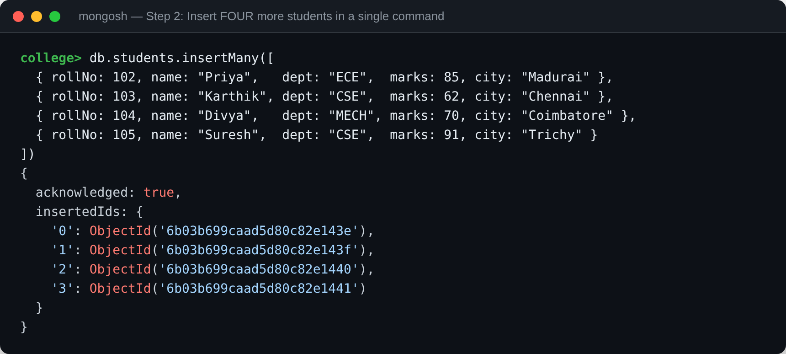

### Step 3

```javascript
db.students.find()
db.students.find({ dept: "CSE" })
```

The first command returns all 5 students. The second returns the 3 CSE students.

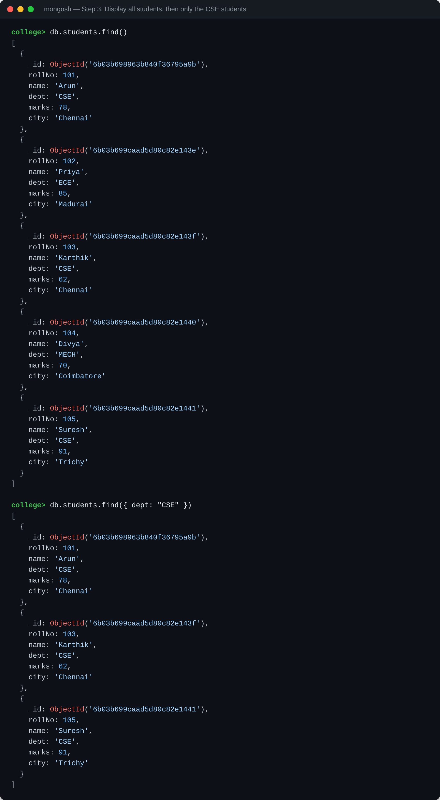

### Step 4

```javascript
db.students.updateOne({ rollNo: 103 }, { $set: { marks: 68 } })
```

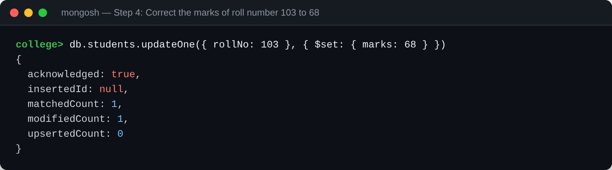

### Step 5

```javascript
db.students.updateMany({ dept: "CSE" }, { $set: { semester: 3 } })
```

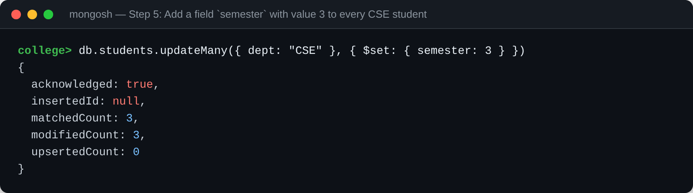

### Step 6

```javascript
db.students.deleteOne({ rollNo: 104 })
```


### Step 7

```javascript
db.students.countDocuments()
```

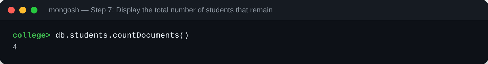

---

## Scenario 1.2: Employee Directory

The HR department of a company stores its employees in MongoDB. Managers keep asking for different lists: highly paid staff, staff in a salary band, staff of selected departments, staff matching two conditions, and a paged salary list. Each list can be produced with a different query operator.

**Requirements**

1. Insert eight employees into the `employees` collection.
2. Find employees who earn more than 60000 using `$gt`.
3. Find employees who earn between 45000 and 60000 (both inclusive) using `$gte` and `$lte`.
4. Find employees of the IT or Finance department using `$in`.
5. Find Chennai employees earning more than 50000 using `$and`, and employees who are in HR or earn more than 70000 using `$or`.
6. Find employees who do not live in Chennai or Bengaluru using `$nin`.
7. Find employees whose name starts with A, B or C using `$regex`.
8. Show only names and salaries, highest salary first, skipping the first two and returning the next three.

### Step 1

```javascript
use hr
db.employees.insertMany([
  { empId: 1, name: "Anita",  dept: "HR",      salary: 42000, city: "Chennai" },
  { empId: 2, name: "Bala",   dept: "IT",      salary: 65000, city: "Bengaluru" },
  { empId: 3, name: "Charan", dept: "IT",      salary: 58000, city: "Chennai" },
  { empId: 4, name: "Deepa",  dept: "Finance", salary: 50000, city: "Mumbai" },
  { empId: 5, name: "Elan",   dept: "IT",      salary: 72000, city: "Chennai" },
  { empId: 6, name: "Farah",  dept: "HR",      salary: 45000, city: "Delhi" },
  { empId: 7, name: "Gopal",  dept: "Finance", salary: 61000, city: "Chennai" },
  { empId: 8, name: "Hema",   dept: "Sales",   salary: 38000, city: "Hyderabad" }
])
```

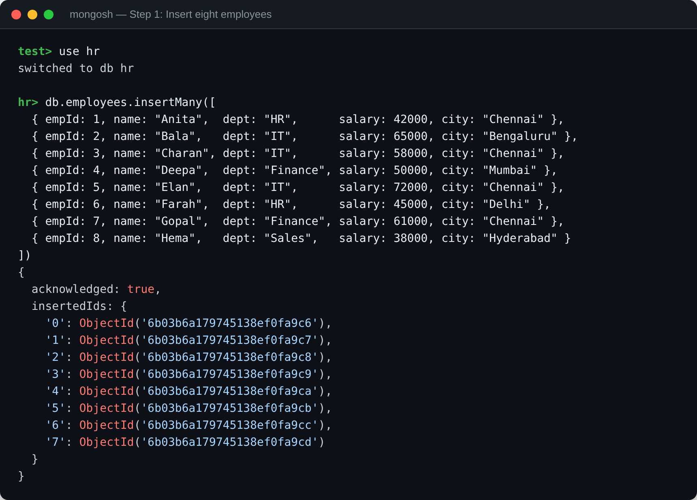

### Step 2

```javascript
db.employees.find({ salary: { $gt: 60000 } })
```

Returns Bala, Elan and Gopal.

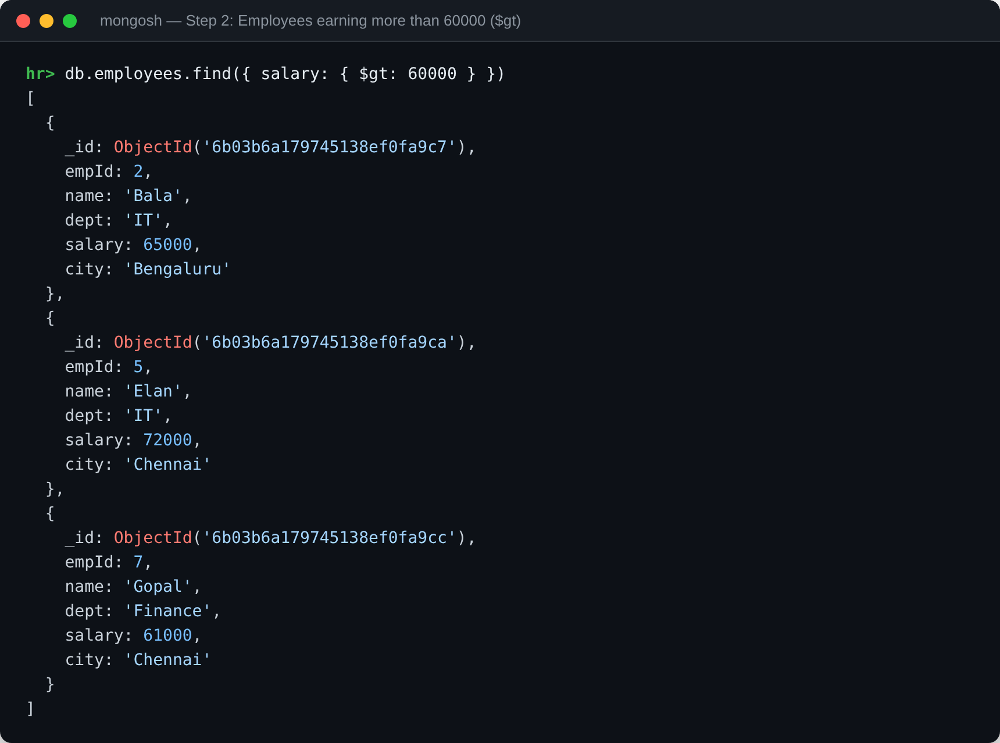

### Step 3

```javascript
db.employees.find({ salary: { $gte: 45000, $lte: 60000 } })
```

Returns Charan, Deepa and Farah.

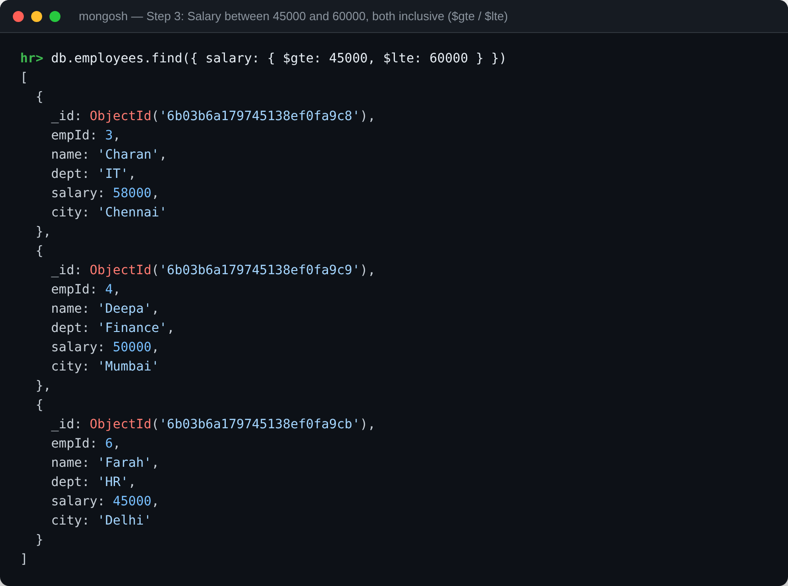

### Step 4

```javascript
db.employees.find({ dept: { $in: ["IT", "Finance"] } })
```

Returns Bala, Charan, Deepa, Elan and Gopal.

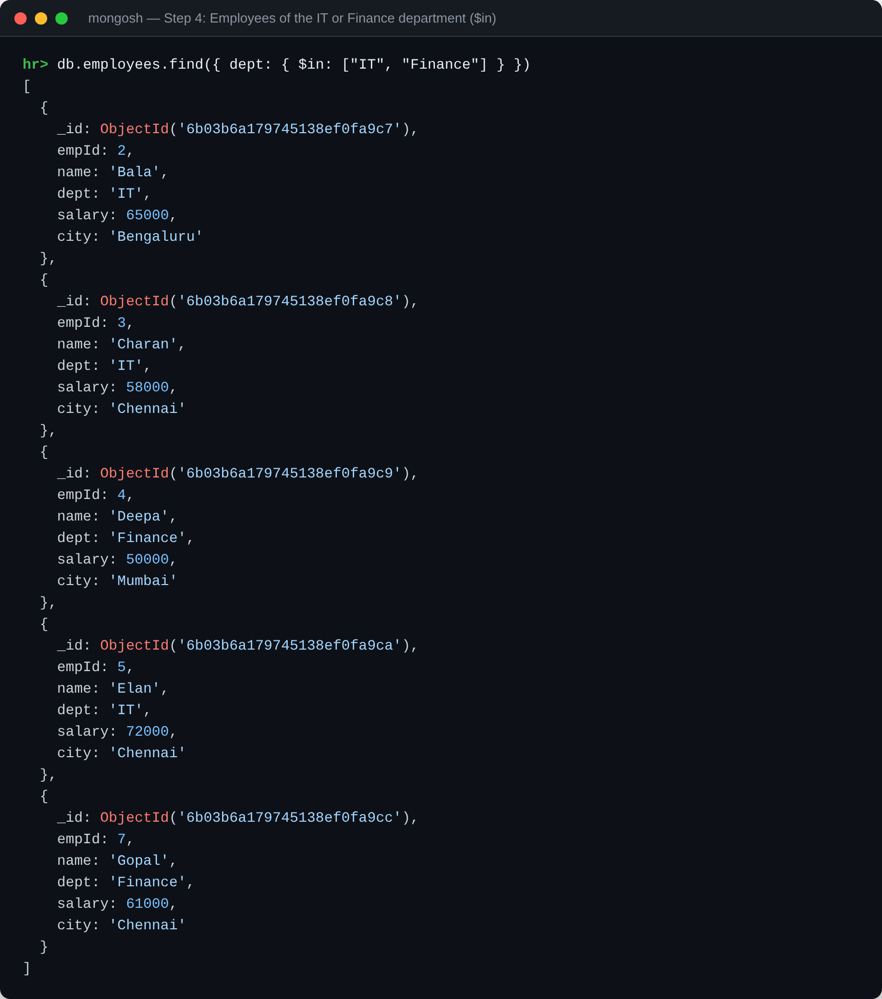

### Step 5

```javascript
db.employees.find({ $and: [ { city: "Chennai" }, { salary: { $gt: 50000 } } ] })
```

Returns Charan, Elan and Gopal.

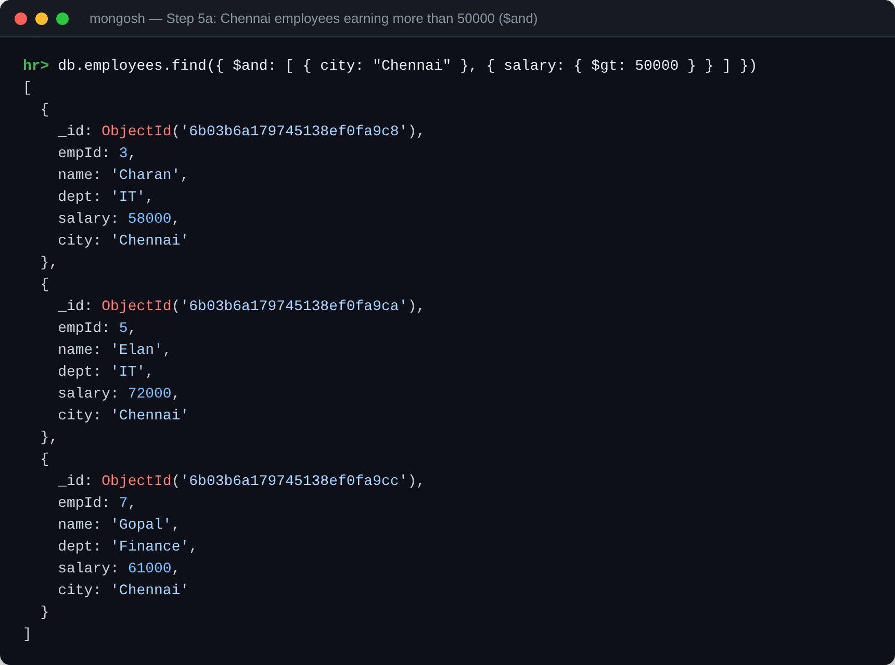

```javascript
db.employees.find({ $or: [ { dept: "HR" }, { salary: { $gt: 70000 } } ] })
```

Returns Anita, Elan and Farah.

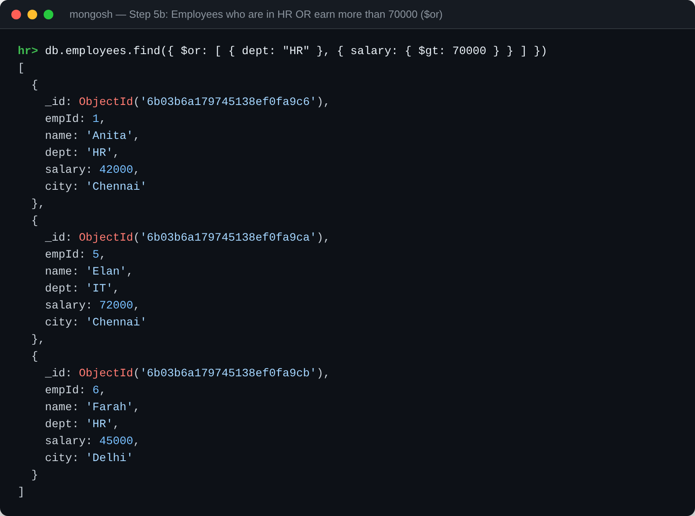

### Step 6

```javascript
db.employees.find({ city: { $nin: ["Chennai", "Bengaluru"] } })
```

Returns Deepa (Mumbai), Farah (Delhi) and Hema (Hyderabad).

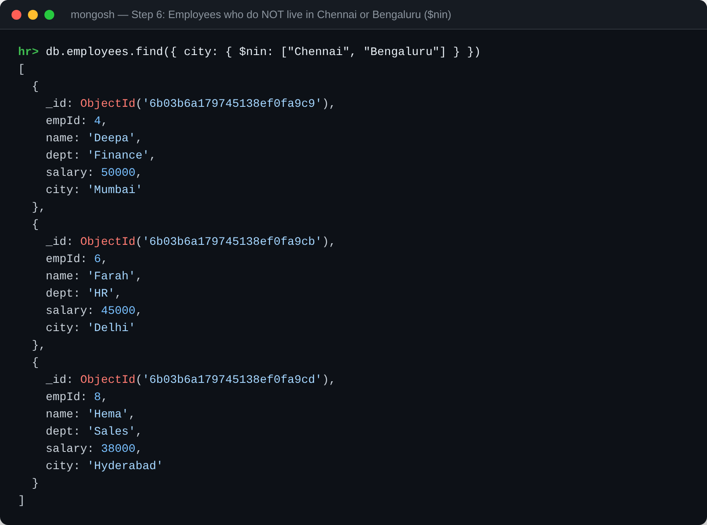

### Step 7

```javascript
db.employees.find({ name: { $regex: /^[ABC]/ } })
```

Returns Anita, Bala and Charan.

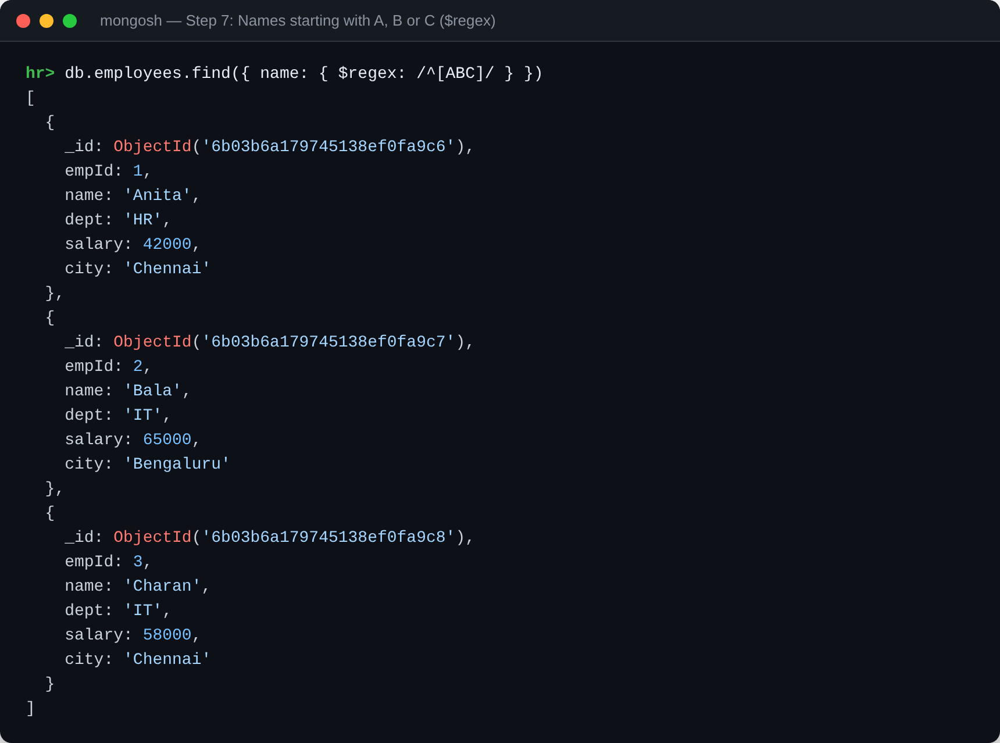

### Step 8

```javascript
db.employees.find({}, { _id: 0, name: 1, salary: 1 }).sort({ salary: -1 }).skip(2).limit(3)
```

The sorted list is Elan, Bala, Gopal, Charan, Deepa, ..., so skipping two and taking three gives Gopal, Charan and Deepa.

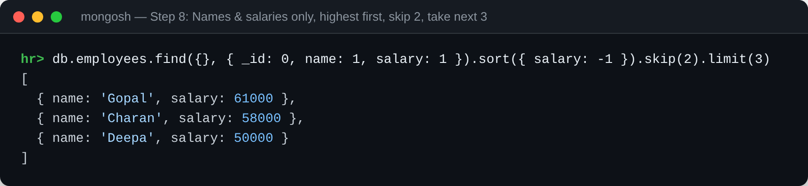

---

## Contributors

- [n3h4a](https://github.com/n3h4a)
