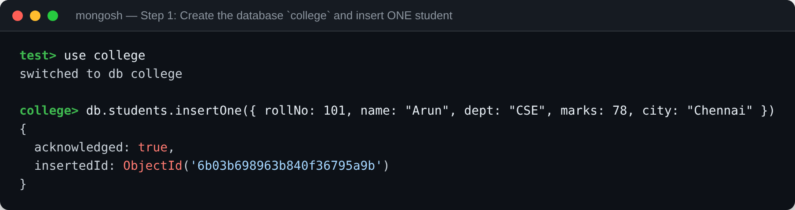

# MongoDB Project 2

Set 1: Operators, Basic Concepts and Database Administration.

This project has two scenarios. Scenario 1.1 covers basic CRUD operations and Scenario 1.2 covers query operators, projection, sort, skip and limit. All queries were run in mongosh, and the screenshots below show the output.

| Scenario | Topic | Database | Collection |
|---|---|---|---|
| 1.1 Student Records | Basic CRUD operations | `college` | `students` |
| 1.2 Employee Directory | Query operators, projection, sort, skip, limit | `hr` | `employees` |

## Files

- `scenario-1.1-student-records/queries.js`: queries for Scenario 1.1
- `scenario-1.1-student-records/output.txt`: full output for Scenario 1.1
- `scenario-1.2-employee-directory/queries.js`: queries for Scenario 1.2
- `scenario-1.2-employee-directory/output.txt`: full output for Scenario 1.2
- `screenshots/`: output screenshots for each step

---

## Scenario 1.1: Student Records

A small college wants to move its student register from a paper file to MongoDB. The office clerk must be able to add new students, look up students by department, correct marks, remove students who have left, and check how many records remain.

**Requirements**

1. Create a database named `college` and insert one student using `insertOne()`.
2. Insert four more students in a single command using `insertMany()`.
3. Display all students, then display only the students of the CSE department.
4. Correct the marks of roll number 103 to 68.
5. Add a field `semester` with the value 3 to every CSE student.
6. Delete the record of roll number 104 (the student has left the college).
7. Display the total number of students that remain.

### Step 1

```javascript
use college
db.students.insertOne({ rollNo: 101, name: "Arun", dept: "CSE", marks: 78, city: "Chennai" })
```



### Step 2

```javascript
db.students.insertMany([
  { rollNo: 102, name: "Priya",   dept: "ECE",  marks: 85, city: "Madurai" },
  { rollNo: 103, name: "Karthik", dept: "CSE",  marks: 62, city: "Chennai" },
  { rollNo: 104, name: "Divya",   dept: "MECH", marks: 70, city: "Coimbatore" },
  { rollNo: 105, name: "Suresh",  dept: "CSE",  marks: 91, city: "Trichy" }
])
```


### Step 3

```javascript
db.students.find()
db.students.find({ dept: "CSE" })
```

The first command returns all 5 students. The second returns the 3 CSE students.


### Step 4

```javascript
db.students.updateOne({ rollNo: 103 }, { $set: { marks: 68 } })
```


### Step 5

```javascript
db.students.updateMany({ dept: "CSE" }, { $set: { semester: 3 } })
```


### Step 6

```javascript
db.students.deleteOne({ rollNo: 104 })
```


### Step 7

```javascript
db.students.countDocuments()
```


